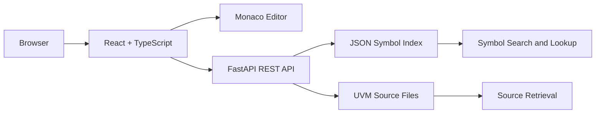

## UVM Explorer

### SystemVerilog Editor & UVM Source Code Navigator

Explore UVM source code, search for symbols, and inspect class, macro, function, and task declarations through a browser-based code editor.

**[Live Demo](https://uvm-explorer.vercel.app/)** · **[GitHub Repository](https://github.com/harshaavenkatasalapathi-eng/UVM-Explorer)** · **[Backend API](https://uvm-explorer-api.onrender.com/docs)**

---

## Overview

UVM Explorer is a web-based tool designed to make exploring Universal Verification Methodology (UVM) source code easier.

It combines the Monaco Editor with a Python FastAPI backend and a locally indexed UVM source repository.

The application currently supports:

- UVM 1.2
- IEEE 1800.2-2020

## Screenshots

## Screenshots

### 1. UVM Explorer – Main Interface

<p align="center">
  
</p>

### 2. Source Explorer

<p align="center">
  

</p>

### 3. Symbol Search

<p align="center">
  
</p>

### 4. Source Code Inspection

<p align="center">
  
</p>


## Features

- **Monaco Editor:** Browser-based code editing experience.
- **UVM Version Selection:** Switch between UVM 1.2 and UVM 1800.2-2020.
- **Symbol Search:** Search for UVM classes, macros, functions, and tasks.
- **Source Lookup:** Inspect indexed symbol declarations.
- **Source Panel:** View the complete source file associated with a selected symbol.
- **Click-to-Peek:** Inspect symbol information without leaving the editor.
- **Local Source Index:** Search using generated JSON indexes rather than making a GitHub request for every lookup.

## Architecture



### Technology Stack

| Component | Technology |
|---|---|
| Frontend | React, TypeScript |
| Code Editor | Monaco Editor |
| Frontend Build Tool | Vite |
| Backend | Python, FastAPI |
| API Server | Uvicorn |
| Index Storage | JSON |
| Source Code | SystemVerilog / UVM |
| Frontend Hosting | Vercel |
| Backend Hosting | Render |
| Version Control | Git and GitHub |

## Project Structure

```text
UVM-Explorer/
│
├── backend/
│   ├── app/
│   │   ├── main.py
│   │   └── indexer.py
│   ├── data/
│   │   ├── 1_2.json
│   │   └── 1800_2_2020.json
│   ├── requirements.txt
│   └── run_indexer.py
│
├── frontend/
│   ├── src/
│   │   ├── api.ts
│   │   ├── App.tsx
│   │   ├── main.tsx
│   │   └── style.css
│   ├── package.json
│   └── vite.config.ts
│
├── uvm_source/
│   ├── 1.2/
│   │   └── src/
│   └── 1800.2-2020/
│       └── src/
│
└── README.md
```

## Getting Started

### Prerequisites

- Git
- Python 3.10 or later
- Node.js 20 or later
- npm

### 1. Clone the repository

```bash
git clone https://github.com/harshaavenkatasalapathi-eng/UVM-Explorer.git
cd UVM-Explorer
```

### 2. Set up the backend

Open a terminal:

```bash
cd backend
python -m venv venv
```

Activate the virtual environment on Windows CMD:

```cmd
venv\Scripts\activate
```

On Linux/macOS:

```bash
source venv/bin/activate
```

Install dependencies:

```bash
pip install -r requirements.txt
```

Generate the symbol indexes:

```bash
python run_indexer.py
```

Start the backend:

```bash
uvicorn app.main:app --reload --host 127.0.0.1 --port 8000
```

Backend URLs:

- Health: http://localhost:8000/api/health
- API documentation: http://localhost:8000/docs

### 3. Set up the frontend

Open a second terminal:

```bash
cd frontend
npm install
```

Create a `.env.local` file inside the frontend directory:

```env
VITE_API_BASE=http://localhost:8000
```

Start the development server:

```bash
npm run dev
```

Open:

http://localhost:5173

### 4. UVM Source Files

The indexer expects the UVM source files under:

```text
uvm_source/
├── 1.2/src/
└── 1800.2-2020/src/
```

If these source files are not present in your checkout, obtain the corresponding reference implementations from their upstream source repositories and place them in the expected directory structure.

Check the upstream licensing terms before redistributing UVM source files.

## API Endpoints

| Method | Endpoint | Purpose |
|---|---|---|
| GET | `/api/health` | Check backend health |
| GET | `/api/versions` | List supported UVM versions |
| GET | `/api/search?q=uvm_driver&version=1800.2-2020` | Search symbols |
| GET | `/api/lookup/uvm_driver?version=1800.2-2020` | Look up a symbol |
| GET | `/api/source?file=src/comps/uvm_driver.svh&version=1800.2-2020` | Retrieve source file |

Interactive API documentation is available at `/docs` on the backend.

## Current Limitations

This project is an MVP focused on UVM source exploration.

- Symbol indexing currently uses lightweight pattern matching rather than a complete SystemVerilog parser.
- Full SystemVerilog preprocessing and macro expansion are not implemented.
- Context-aware overload resolution is not implemented.
- Full F12 / Go to Definition navigation is a future enhancement.
- User-defined editor symbols are not independently indexed.

## Deployment

| Service | Platform |
|---|---|
| Frontend | [Vercel](https://uvm-explorer.vercel.app/) |
| Backend | [Render](https://uvm-explorer-api.onrender.com/) |
| Source Repository | [GitHub](https://github.com/harshaavenkatasalapathi-eng/UVM-Explorer) |

The backend may take longer to respond after inactivity because the Render free instance can spin down.

## Future Enhancements

- F12 – Go to Definition.
- Alt+F12 – Peek Definition.
- Improved SystemVerilog parsing.
- UVM macro expansion.
- Cross-reference navigation.
- Enhanced symbol indexing and search.

## License

A project license has not yet been selected. Check the licensing terms of the included UVM reference source before choosing a license for this repository.

---

**UVM Explorer — Let's save time exploring UVM.**
